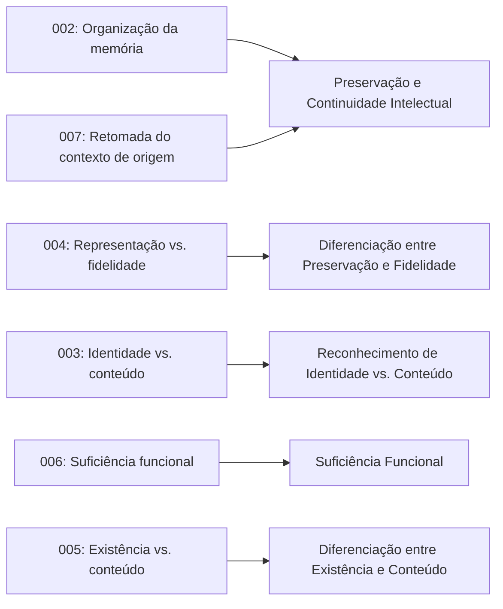

# Relatório Técnico e Conceitual — `BB-CORE-EXP-001` v0.1.0

**Data de execução:** 24/11/2026 (`2026-11-24T20:35:40Z` UTC)  
**Natureza:** Investigação experimental isolada (sem alteração no núcleo canônico, no schema SQLite ou no diário `BB-EVENT-1`)  
**Script executor:** [`lab/exp001/run_exp001.py`](run_exp001.py)  
**Dados brutos integrais:** [`lab/exp001/results.json`](results.json)

---

## 1. Infraestrutura e modelos identificados

Levantamento realizado na estação de trabalho local:

- **GPU:** AMD Radeon RX 7900 (`Navi 31`) + iGPU Radeon 610M (`Raphael`).
- **Memória RAM:** 61 GiB totais (52 GiB disponíveis antes da execução).
- **Motor de inferência local:** `ollama serve` ativo em `127.0.0.1:11434`.
- **Modelos locais relevantes já instalados:**
  - `qwen2.5:14b` (9,0 GB em disco; ~12 GB em VRAM durante execução `100% GPU`; suporte nativo a JSON Schema via parâmetro `format`).
  - `gemma3:12b` (8,1 GB, `Q4_K_M`, janela de contexto `131072`).
  - `qwen2.5:7b` (4,7 GB), `mistral:7b` (4,4 GB), `llama3:8b` (4,7 GB), `qwen3-coder:30b` (18 GB), além de modelos de embedding (`nomic-embed-text`, `qwen3-embedding:4b`).
- **Configuração utilizada no experimento:** `qwen2.5:14b`, `temperature: 0.1`, `num_ctx: 16384`, **100% GPU** confirmado via `ollama ps`.

---

## 2. Protocolo experimental utilizado

- **Universo analisado:** exclusivamente os 6 registros reais preservados no BB-CORE local (`BB-CORE-INSIGHT-002` a `BB-CORE-INSIGHT-007`, todos na versão `1`), lidos via API somente-leitura (`GET /api/insights` e `GET /api/insights/<id>/context`).
- **Restrição epistemológica estrita:** nenhuma lista de dimensões, palavras-chave, quantidade esperada ou pontuação numérica foi fornecida nos prompts.
- **Experimentos executados:**
  - **Experimento A (Individual):** 6 chamadas independentes, 1 registro por chamada.
  - **Experimento B (Coletivo):** 1 chamada única com todos os 6 registros.
  - **Experimento C1 (Incremental cronológico):** 6 chamadas sequenciais (`002 → 003 → 004 → 005 → 006 → 007`), passando o estado analítico da etapa anterior.
  - **Experimento C2 (Incremental inverso):** 6 chamadas sequenciais (`007 → 006 → 005 → 004 → 003 → 002`).

---

## 3. Tempo de execução e consumo de recursos

| Experimento | Chamadas | Tempo total (s) | Tokens de prompt | Tokens gerados | Execução |
|---|---:|---:|---:|---:|---|
| **A — Individual** | 6 | 61,24 s | 3.157 | 3.754 | 100% GPU |
| **B — Coletivo** | 1 | 19,40 s | 1.911 | 1.314 | 100% GPU |
| **C1 — Incremental (cronológico)** | 6 | 62,23 s | 5.416 | 4.237 | 100% GPU |
| **C2 — Incremental (inverso)** | 6 | 63,24 s | 5.663 | 4.306 | 100% GPU |
| **Total** | **19** | **206,11 s (~3m 26s)** | **16.147** | **13.611** | **12 GB VRAM (`ollama ps`)** |

---

## 4. Resultados integrais resumidos e comparação entre A, B e C

### Experimento A — Análise individual
- O modelo extraiu conceitos fiéis aos textos e produziu **abstenções explícitas pertinentes** em 5 dos 6 registros:
  - Em `002`: absteve-se sobre *"Relação com achados anteriores"* e *"Confronto sistemático com literatura ou usuários"*.
  - Em `004`: absteve-se de propor dimensão específica sobre integridade de bytes além do texto fornecido.
  - Em `006`: absteve-se de transformar `"MCP permanece fora desta etapa"` e `"Validação em nova conversa foi deliberadamente adiada"` em dimensões conceituais por falta de detalhamento.
- **Limitação observada:** granularidade muito desigual — propôs **7 dimensões** para `006` (incluindo tópicos operacionais como *Escopo do MCP* e *Denominação de Fases*) e apenas **2** para `007` (*Mobilidade Contextual*, *Preservação de Contexto*).

### Experimento B — Análise coletiva
- Propôs **5 dimensões**, todas fundamentadas por **trechos literais exatos** dos registros:
  1. **Preservação e Continuidade Intelectual** — associou `002` e `007` (*2 registros*).
  2. **Diferenciação entre Preservação e Fidelidade** — associou `004` (*1 registro*).
  3. **Reconhecimento de Identidade vs. Conteúdo** — associou `003` (*1 registro*).
  4. **Suficiência Funcional** — associou `006` (*1 registro*).
  5. **Diferenciação entre Existência e Conteúdo** — associou `005` (*1 registro*).
- **Limitação observada:** embora coerente, o modelo tendeu à **correspondência 1-para-1** (4 das 5 dimensões têm apenas 1 registro), atuando mais como rotulagem temática individual do que como síntese transversal (por exemplo, não agrupou `003`, `004` e `005` sob uma dimensão transversal de *Fidelidade e Identidade da Representação*, nem listou justificativa textual em `singularities`).

### Experimento C — Análise incremental e influência da ordem (C1 vs. C2)

A comparação entre C1 e C2 revelou **sensibilidade severa à ordem** e **perda do estado acumulado** (*state drift*):

- **Em C1 (`002 → 007`):**
  - Passo 1 (`002`): criou *Organização da memória vs organização da atividade intelectual*.
  - Passo 2 (`003`/`005`): reescreveu `dimensions_state` apenas com a nova dimensão, **descartando** a do passo 1.
  - Passo 4 (`003`): descartou as dimensões dos passos 1–3.
  - Passo 6 (estado final): restaram **3 dimensões** (*Continuidade intelectual pela retomada do contexto de origem*, *Suficiência funcional...*, *Priorização de correções essenciais...*), com **1 registro cada** — perdendo `002`, `003`, `004` e `005` do estado final!
- **Em C2 (`007 → 002`):**
  - Passo 1 (`007`): propôs 3 dimensões (*Continuidade Intelectual*, *Contexto de Origem*, *Mobilização de Achados*).
  - Passo 2 (`006`): descartou as 3 anteriores e manteve apenas *Suficiência Funcional* (abstendo-se de vincular `006` a *Continuidade Intelectual*).
  - Passo 3 (`003`): descartou *Suficiência Funcional* e criou *Reconhecimento de Identidade vs Confirmação Integral do Conteúdo*.
  - Passos 4, 5 e 6 (`004`, `005`, `002`): todas foram absorvidas por essa única dimensão (totalizando **4 registros**), e no passo 6 (`002`) o modelo se absteve de criar nova dimensão alegando que *"não justifica a criação de uma nova dimensão"*.

---

## 5. Representação gráfica experimental (estrutura obtida no Experimento B)

---

## 6. Associações fundamentadas vs. questionáveis e exemplos de abstenção

- **Associação mais bem fundamentada:** em **B**, *Preservação e Continuidade Intelectual* conectando `002` (*"A continuidade pode ser sustentada entre ambientes distintos..."*) e `007` (*"A continuidade intelectual não se restringe à recuperação do conhecimento produzido..."*) — síntese conceitual genuína apoiada em trechos literais.
- **Associações questionáveis:**
  - Em **C2 (passo 6)**, forçar `002` (*organização da memória vs. atividade intelectual*) dentro de *Reconhecimento de Identidade vs Confirmação Integral do Conteúdo* apenas para evitar criar nova dimensão.
  - Em **C1 (passo 6)**, o campo `newly_proposed_dimensions` misturou strings de definição e justificativa dentro de um array de nomes de dimensões.
- **Exemplos de abstenção bem-sucedida:**
  - **C2 (passo 2):** *"Não há fundamento suficiente no novo registro para associar diretamente a dimensão 'Continuidade Intelectual', pois o conceito de mobilização e retomada de contextos não é abordado neste contexto."*
  - **A (`006`):** recusa explícita em transformar menções operacionais (*"MCP permanece fora desta etapa"*) em dimensões conceituais sem base suficiente.

---

## 7. Recomendações fundamentadas para a próxima etapa

1. **Não delegar a manutenção do estado acumulado à LLM:** o experimento incremental demonstrou que pedir à LLM para reescrever todo o grafo acumulado em JSON causa *state drift* (apagamento silencioso de dimensões e registros anteriores). O código determinístico do BB-CORE deve **guardar o estado** e solicitar à LLM apenas **operações atômicas** (propor associação a dimensão existente, propor nova dimensão ou sugerir revisão), preservando o histórico sem sobrescrita.
2. **Separar etapa de síntese coletiva da etapa de associação:** usar a análise individual (A) para extrair conceitos candidatos com alta fidelidade textual e a síntese coletiva (B) — com instrução explícita para identificar eixos transversais compartilhados — para propor dimensões candidatas que agrupem múltiplos registros.
3. **Manter o léxico atual como baseline determinística na UI:** enquanto a camada experimental com LLM não possuir controle determinístico de estado e revisão humana explícita das dimensões propostas, o grafo lexical auditável (`bb-analytics-lexicon/0.1.0`) continua sendo a opção segura e reproduzível para a página inicial.
4. **Próximo experimento sugerido (`BB-CORE-EXP-002`):** repetir a comparação usando o mesmo protocolo com **estado gerenciado fora da LLM** (operações atômicas) e comparar `qwen2.5:14b` vs. `gemma3:12b` sobre um corpus ampliado (incluindo registros de outros domínios, como o documento MÉTIS).
